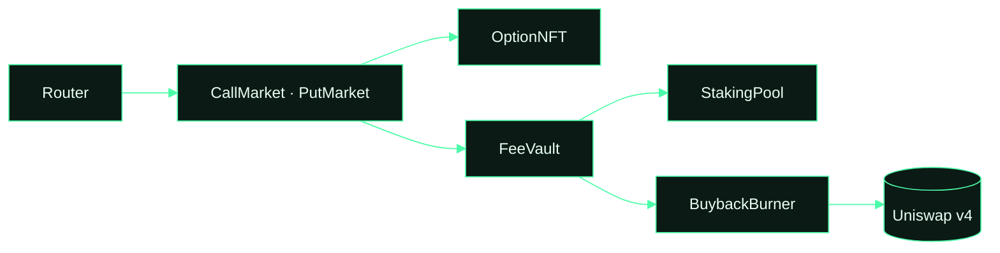

# kyte-abis

ABIs, addresses and TypeScript types for every Kyte contract on Robinhood Chain. Use it to read offers, build
transactions or index events without copying anything from the app.

```bash
npm install github:usekyte/kyte-abis
```

```ts
import { abis, addresses, chainId } from 'kyte-abis'
import { createPublicClient, http } from 'viem'

const client = createPublicClient({ transport: http('https://rpc.mainnet.chain.robinhood.com') })
const open = await client.readContract({
  address: addresses.v3.callMarket,
  abi: abis.CallMarket,
  functionName: 'offer',
  args: [1n],
})
```

## What is here

| File | Contents |
|---|---|
| `abis/*.json` | One JSON ABI per contract, straight from the compiled artifacts |
| `addresses.json` | Every live address on chain id 4663, including the v2 and v3 market sets and listed tokens |
| `index.mjs`, `index.d.ts` | `abis`, `addresses`, `chainId`, typed with `as const` for viem and wagmi |

## What talks to what



## Events worth indexing

| Contract | Event | When |
|---|---|---|
| CallMarket / PutMarket | `OfferCreated`, `OptionBought`, `Exercised`, `Expired`, `OfferCancelled` | the option lifecycle |
| FeeVault | `FeesSplit` | once per epoch |
| BuybackBurner | `Burned` | every buyback |
| StakingPool | `Staked`, `Unstaked`, `Claimed` | staking activity |

## Live addresses

{{CONTRACTS}}

Report vulnerabilities to contact@kyte.sh. Kyte is not affiliated with or endorsed by Robinhood.
