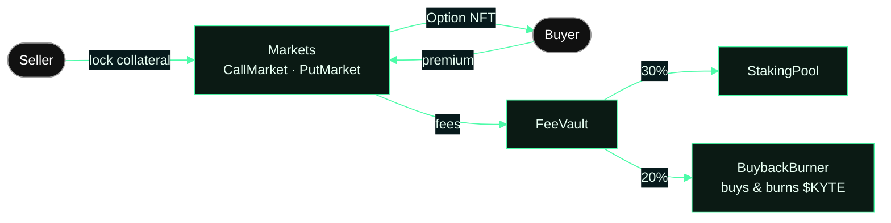
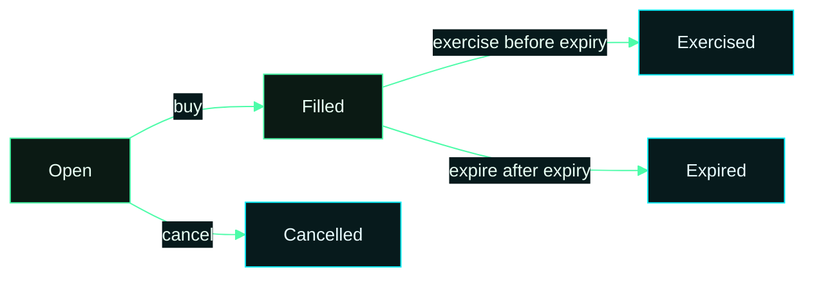

# Kyte contracts

Kyte is a non-custodial, fully collateralised options market on Robinhood Chain. Sellers lock the full collateral,
buyers pay a premium and receive an Option NFT (ERC-721), and settlement is enforced by the contracts alone. There is
no leverage, no margin and no liquidation path.

This repository holds the Solidity sources, tests and deploy scripts. Addresses of the live deployment are in
[`CONTRACTS.md`](CONTRACTS.md); every token options can be written on is in [`MARKETS.md`](MARKETS.md). The web app
and indexer live in [usekyte/Kyte-Market](https://github.com/usekyte/Kyte-Market), the staking contracts with their
tests in [usekyte/Kyte-StakingPool](https://github.com/usekyte/Kyte-StakingPool).

## Contracts

| Contract | Role |
|---|---|
| `AssetRegistry` | Listed tokens, exposure caps and minimum strikes |
| `CallMarket` / `PutMarket` | Offers, fills, exercise, expiry and cancellation for covered calls and cash-secured puts |
| `OptionNFT` | One ERC-721 per bought option, with on-chain art and metadata |
| `Router` | Buy and exercise with plain ETH (wraps to WETH) |
| `FeeVault` | Collects the premium and exercise fees and splits them once per epoch |
| `StakingPool` | $KYTE staking; stakers receive their share of fees in WETH |
| `BuybackBurner` | Buys $KYTE on Uniswap v4 with the buyback share and burns it |
| `UniswapV4Adapter` | Direct PoolManager swaps for the burner |
| `KyteHook` | Uniswap v4 hook on the $KYTE/WETH pool: TWAP and swap fee |

Fee split, enforced on chain: 30% to stakers, 20% buyback and burn, 50% operations.

## How the contracts fit



Registry, Router and KyteHook sit around this core: the AssetRegistry decides what can be listed, the Router lets
users pay in plain ETH, and the hook on the $KYTE/WETH pool feeds its swap fee and a TWAP into the same vault.

## One option, four states



Status only moves forward. Collateral leaves the contract exactly once, to the holder on exercise or back to the
seller otherwise.

## Live addresses

{{CONTRACTS}}

## Build and test

```bash
pnpm install          # Uniswap v4 and OpenZeppelin sources
forge build
forge test
```

Requires [Foundry](https://getfoundry.sh) and Node 24 with pnpm.

## Governance

Settings change only through a TimelockController with a 10 minute minimum delay, within ceilings hard-coded in the
contracts. A guardian can pause new offers and buys or disable a token; it cannot unpause, enable or move funds.
Collateral in escrow can only ever go to its seller or to the option holder.

## Security

Report vulnerabilities to contact@kyte.sh. Please do not disclose publicly before we have responded.

Options can expire worthless. Nothing here is investment advice. Kyte is built on Robinhood Chain and is not
affiliated with or endorsed by Robinhood.
