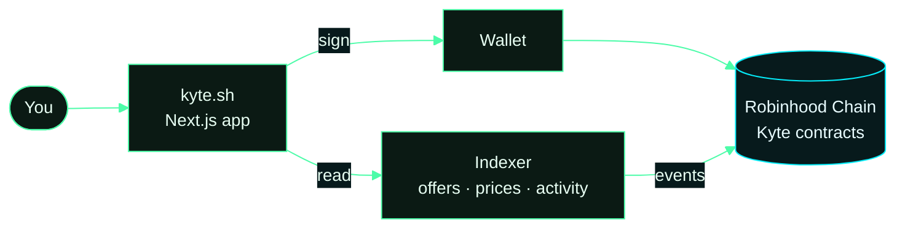

# Kyte Market

The web app and indexer behind [kyte.sh](https://kyte.sh): a non-custodial, fully collateralised options market on
Robinhood Chain. Sell covered calls and cash-secured puts on listed tokens, buy options as transferable NFTs, and
stake $KYTE for a share of every protocol fee.

No leverage, no margin, no liquidations. A seller locks the full collateral in the market contract before an offer
exists; a buyer pays the premium and receives an Option NFT; exercise or expiry settles it. No admin can move escrow.

## How it fits together



The app reads from the indexer for speed and signs against the contracts directly. Amounts, spenders and recipients
never come from the indexer: they come from the deployment config and are re-checked on chain.

## Pages

| Page | What it does |
|---|---|
| `/market` | Live price per token (Uniswap v4 swaps and Robinhood quotes), every open offer, one-click buy, recent trades with explorer links |
| `/sell` | Write a covered call (lock tokens) or a cash-secured put (lock WETH): amount, strike per token, premium, expiry, fill-by deadline |
| `/positions` | Options you sold or hold, exercise, cancel unfilled offers, add the Option NFT to your wallet |
| `/stake` | Stake and unstake $KYTE, claim WETH rewards, epoch countdown |
| `/proof` | Every fee split and buyback burn with its transaction |
| `/trades` | Full market history: listings, fills, exercises, expiries, cancellations |
| `/docs` | How it works, fees, risks, contracts |

## What is here

| Folder | What it is |
|---|---|
| `src/` | Next.js 16 app (React 19, wagmi 2, viem 2, Tailwind 4, Framer Motion, GSAP, Lenis) |
| `indexer/` | Node service that indexes the contracts' events and serves the app's API: offers, positions, prices, candles, activity, stake, proof |
| `public/` | Brand assets |
| `contracts/deployments/4663.json` | Addresses the app and indexer read |

Contract sources: [usekyte/kyte-contract-v2](https://github.com/usekyte/kyte-contract-v2). Staking:
[usekyte/Kyte-StakingPool](https://github.com/usekyte/Kyte-StakingPool).

## Protocol contracts

{{CONTRACTS}}

## Listed markets

{{MARKETS}}

## Fees

Two fees, fixed per position at creation and enforced by the contracts: a premium fee when an option is bought and an
exercise fee when it is exercised. Every fee is split on chain once per epoch: 30% to $KYTE stakers in WETH, 20% to
buy $KYTE on Uniswap v4 and burn it, 50% to operations. No other protocol fees exist.

## Run locally

```bash
pnpm install
cp .env.example .env.local      # set NEXT_PUBLIC_PRIVY_APP_ID (your Privy app) and NEXT_PUBLIC_INDEXER_URL
pnpm dev                        # http://localhost:3010
```

Indexer, against Robinhood Chain mainnet:

```bash
CHAIN_ID=4663 RPC_URL=https://rpc.mainnet.chain.robinhood.com node indexer/src/index.mjs   # http://localhost:4200
```

Requires Node 24 and pnpm. Without an indexer URL the app reads the chain directly from the browser, with fewer
features (no price history or activity feed).

## Security

Report vulnerabilities to contact@kyte.sh. Please do not disclose publicly before we have responded.

Options can expire worthless. Nothing here is investment advice. Not available where prohibited. Kyte is built on
Robinhood Chain and is not affiliated with or endorsed by Robinhood.
