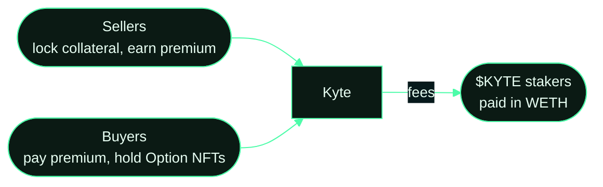

  

<h1 align="center">Kyte</h1>

<strong>Options, on your terms.</strong> 
A non-custodial, fully collateralised options market on Robinhood Chain.

  <a href="https://kyte.sh">kyte.sh</a> ·
  <a href="https://kyte.sh/market">Market</a> ·
  <a href="https://kyte.sh/stake">Stake</a> ·
  <a href="https://kyte.sh/docs">Docs</a> ·
  <a href="https://x.com/useKyte">@useKyte</a>

---

Sell covered calls and cash-secured puts on {{MARKET_COUNT}} listed tokens, buy options as transferable NFTs, and stake
$KYTE for a share of every protocol fee. No leverage, no margin, no liquidations: a seller locks the full collateral
before an offer exists, and no admin can touch escrow.

## Repositories

| Repo | What it is |
|---|---|
| [kyte-contract-v2](https://github.com/usekyte/kyte-contract-v2) | All protocol contracts: markets, Option NFT, router, fee vault, staking, buyback, Uniswap v4 hook. Tests and deploy scripts |
| [Kyte-StakingPool](https://github.com/usekyte/Kyte-StakingPool) | The $KYTE staking pool, fee vault and buyback burner with their tests |
| [Kyte-Market](https://github.com/usekyte/Kyte-Market) | The web app at kyte.sh and the indexer that serves it |
| [kyte-abis](https://github.com/usekyte/kyte-abis) | ABIs, addresses and TypeScript types for integrators |
| [kyte-docs](https://github.com/usekyte/kyte-docs) | Protocol documentation in Markdown |

## $KYTE

| | |
|---|---|
| Contract | [`{{KYTE}}`](https://robinhoodchain.blockscout.com/address/{{KYTE}}) |
| Chain | Robinhood Chain (chain id 4663) |
| Fee split | 30% to stakers in WETH, 20% buyback and burn, 50% operations, enforced on chain |
| Trade | [Uniswap v4 via Pons](https://ponsfamily.com/launchpad/{{KYTE_LC}}) · [Stake](https://kyte.sh/stake) |

## Security

Report vulnerabilities to contact@kyte.sh. See the SECURITY.md in any repository.

Options can expire worthless. Nothing here is investment advice. Kyte is built on Robinhood Chain and is not
affiliated with or endorsed by Robinhood.
