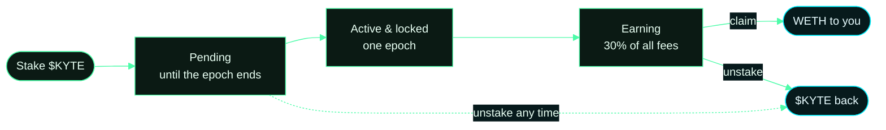

# Kyte StakingPool

The $KYTE staking pool and the fee path that feeds it: `FeeVault` collects every protocol fee, `StakingPool` pays
stakers their share in WETH, and `BuybackBurner` buys $KYTE on Uniswap v4 and burns it. The remaining sources in
`src/` are included so the project compiles and the tests run against the real markets.

## How staking works

- Stake $KYTE any time. New stake is **pending** until the current epoch (1 day) ends, then becomes **active**.
- Active stake earns its share of the epoch's fees, paid in WETH, claimable with `claim()`.
- Stake that just became active is locked for one full epoch. Pending stake can be unstaked at any time.
- Fee split, enforced on chain: 30% to stakers, 20% buyback and burn, 50% operations.

## A staker's journey



Fees arrive in WETH from the markets and the Uniswap v4 hook. Once per epoch the FeeVault splits them: 30% to this
pool, 20% to the BuybackBurner which buys $KYTE on Uniswap v4 and burns it, 50% to operations.

All protocol contracts: [usekyte/kyte-contract-v2](https://github.com/usekyte/kyte-contract-v2). The app:
[usekyte/Kyte-Market](https://github.com/usekyte/Kyte-Market). Listed tokens: [`MARKETS.md`](MARKETS.md).

## Live addresses

{{CONTRACTS}}

## Build and test

```bash
pnpm install
forge build
forge test
```

Requires [Foundry](https://getfoundry.sh) and Node 24 with pnpm.

## Security

Report vulnerabilities to contact@kyte.sh. Please do not disclose publicly before we have responded.

Nothing here is investment advice. Kyte is built on Robinhood Chain and is not affiliated with or endorsed by Robinhood.
